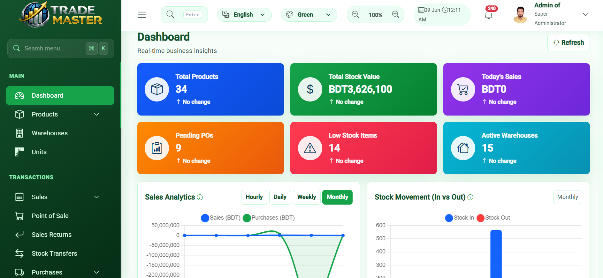

# TradeMaster Backend

Spring Boot REST API backend for the **TradeMaster Inventory and Stock Management System**.

<p>
  
  
  
  
  
  
  
</p>

## Live Application & Deployment

**TradeMaster is deployed and accessible online.**

| Service | Platform | Link |
|---|---|---|
| Backend REST API | Render | [Live Backend](https://trademaster-spring-boot-backend.onrender.com) |
| Frontend Application | Vercel | [Live TradeMaster](https://trademaster-angular-frontend.vercel.app/login) |
| Database | Aiven Cloud | MySQL 8.x |
| Backend Source | GitHub | [Backend Repository](https://github.com/mdwoalinur/trademaster-spring-boot-backend) |
| Frontend Source | GitHub | [Frontend Repository](https://github.com/mdwoalinur/trademaster-angular-frontend) |
| Project Demo | YouTube | [Watch Demo Video](https://www.youtube.com/watch?v=eN976DJnotM) |


**Live Frontend Website:**

https://trademaster-angular-frontend.vercel.app/login

> The backend runs on Render. When the instance is inactive, the first request may require additional startup time.
>
> **Official IsDB-BISEW Project Showcase:** [View TradeMaster — Inventory & Stock Management System](https://www.isdb-bisew.org/it-scholarship-programme/500/Project-Name---Inventory-%26-Stock-Management-System)


---
## Dashboard Preview



---

## Overview

TradeMaster Backend provides secure and modular REST APIs for inventory management, stock operations, sales, purchases, payments, financial workflows, reporting, notifications, audit logging, and user administration.

This backend is designed to work with the TradeMaster Angular frontend.

The project was developed under the **IsDB-BISEW IT Scholarship Programme** as an academic Inventory and Stock Management System.

The backend handles business logic, authentication, authorization, database operations, and REST API communication.

---

## Related Repository

**Angular Frontend:**

https://github.com/mdwoalinur/trademaster-angular-frontend

---

## Main Features

- JWT-based authentication and authorization
- Role-based access control
- User and role administration
- Product and product variation management
- Category, unit, supplier, customer, and warehouse management
- Purchase and purchase return workflows
- Sales and sales return workflows
- Inventory tracking and stock movement management
- Stock adjustments and warehouse transfers
- Low-stock monitoring
- Payment approval and posting workflow
- Financial account and ledger management
- Expense management
- Payment reconciliation and reporting
- Profit and loss reporting
- Sales, purchase, inventory, and tax reports
- Global search functionality
- Audit logging
- Notification management
- Email and invoice communication foundation
- File upload and secured download support

---

## Technology Stack

### Backend

- Java 17
- Spring Boot 4.0.3
- Spring Security
- Spring Data JPA
- Hibernate
- MySQL
- Maven
- JWT Authentication
- REST API
- AOP Auditing
- SQL-based schema migration scripts

### Database

- MySQL 8.x
- Aiven Cloud MySQL

### Deployment

- Render — Spring Boot REST API
- Vercel — Angular Frontend
- Aiven Cloud — MySQL Database
- GitHub — Source Code and Version Control
- Docker — Backend Container Deployment

---

## System Architecture

TradeMaster follows a separated frontend, backend, and database architecture.

```text
                  User / Browser
                         |
                         v
                  Angular Frontend
                      (Vercel)
                         |
                    HTTPS / JSON
                         |
                         v
                  Spring Boot API
                      (Render)
                         |
                 Spring Security
                    JWT Filter
                         |
                         v
                  REST Controllers
                         |
                         v
                   Service Layer
                         |
                         v
                 Repository Layer
                  Spring Data JPA
                         |
                         v
                    Hibernate
                         |
                         v
                  MySQL Database
                   (Aiven Cloud)
```

### Backend Responsibilities

- Authentication and authorization
- Request validation and error handling
- Business logic processing
- Database interaction
- Role-based API access
- Inventory and stock operations
- Financial transaction processing
- Report generation
- Audit and notification handling

---

## Requirements

- Java 17
- MySQL 8.x
- Maven 3.9+
- Git
- A database named `trademaster` or a configured database URL
- Angular frontend for browser-based interaction

---

## Installation

### 1. Clone the Repository

```bash
git clone https://github.com/mdwoalinur/trademaster-spring-boot-backend.git
```

### 2. Navigate to the Project Directory

```bash
cd trademaster-spring-boot-backend
```

### 3. Configure MySQL

Create or prepare a MySQL database named:

```sql
CREATE DATABASE IF NOT EXISTS trademaster;
```

If using an existing TradeMaster database, configure the application to use that database instead.

Existing schema and data should be backed up before applying migrations or initialization scripts.

### 4. Configure Environment Variables

Set the required database and JWT configuration in your local environment.

### 5. Build the Application

```bash
mvn clean verify
```

### 6. Run the Backend

```bash
mvn spring-boot:run
```

The default local backend URL is:

http://localhost:8080

**Local API Base URL:**

http://localhost:8080/api

---

## Required Environment Variables

TradeMaster uses environment variables for database connectivity and JWT security.

### Local Development Example

```env
TRADEMASTER_DB_URL=jdbc:mysql://localhost:3306/trademaster
TRADEMASTER_DB_USERNAME=root
TRADEMASTER_DB_PASSWORD=<your-local-database-password>
TRADEMASTER_JWT_SECRET=<your-secure-random-secret>
```

### Production Database Configuration

The production backend connects to Aiven Cloud MySQL.

Example configuration:

```env
TRADEMASTER_DB_URL=jdbc:mysql://<AIVEN_HOST>:<AIVEN_PORT>/trademaster?sslMode=REQUIRED
TRADEMASTER_DB_USERNAME=<AIVEN_USERNAME>
TRADEMASTER_DB_PASSWORD=<AIVEN_PASSWORD>
TRADEMASTER_JWT_SECRET=<secure-random-JWT-secret>
```

The database credentials and JWT secret must be configured in the hosting environment.

### JWT Security

Use a cryptographically secure signing key appropriate for the configured JWT algorithm.

For HS512, use at least 64 bytes of random key material.

Never commit actual database passwords, JWT secrets, or other sensitive credentials to GitHub.

---

## Database Configuration

### Database Name

```text
trademaster
```

### Production Database

| Setting | Value |
|---|---|
| Database | MySQL 8.x |
| Hosting | Aiven Cloud |
| Schema | `trademaster` |
| Connection | JDBC |
| SSL | Required |

The backend connects to the database using Spring Data JPA and Hibernate.

### Database Security

- Database credentials remain on the backend.
- The Angular frontend does not connect directly to MySQL.
- Production database passwords must not appear in public repositories.
- Back up production data before applying schema changes.

---

## REST API

### Development API Base URL

```text
http://localhost:8080/api
```

### Production API Base URL

```text
https://trademaster-spring-boot-backend.onrender.com/api
```

### Authentication

The application uses Spring Security and JWT authentication.

**Login Endpoint:**

```http
POST /api/auth/login
```

After successful authentication, the backend returns authentication information for the frontend application.

The Angular frontend uses the authenticated session to access secured application functionality.

### API Processing Flow

```text
Client Request
      |
      v
Spring Security / JWT
      |
      v
Controller
      |
      v
Service
      |
      v
Repository
      |
      v
MySQL Database
      |
      v
JSON Response
```

API permissions are enforced on the backend rather than relying only on frontend navigation restrictions.

---

## Authentication and Authorization

TradeMaster uses Spring Security with JWT-based authentication.

### Security Features

- JWT-based authentication
- Role-based authorization
- Secured REST API endpoints
- Password hashing
- Authentication error handling
- Protected business operations
- CORS restrictions for approved frontend origins

### Production CORS Configuration

The backend allows the following frontend origins:

```text
https://trademaster-angular-frontend.vercel.app
http://localhost:4200
```

Wildcard origins are not enabled.

The CORS configuration supports the permitted HTTP methods, headers, and preflight requests.

### Authentication Verification

The production authentication flow has been tested successfully:

- Spring Boot backend deployed on Render
- Angular frontend deployed on Vercel
- MySQL connection established through Aiven
- Administrator login successful
- Administrator dashboard opened successfully

Other role-based workflows and business modules require their own verification.

---

## Build and Testing

### Run Tests

```bash
mvn test
```

### Clean Build and Verification

```bash
mvn clean verify
```

### Package Application

```bash
mvn clean package
```

### Run Packaged Application

```bash
java -jar target/trademaster_ims-0.0.1-SNAPSHOT.jar
```

The application can also be built and deployed using the project's Dockerfile.

---

## Deployment — Render

The Spring Boot backend is deployed as a Docker-based web service on Render.

**Live Backend:**

https://trademaster-spring-boot-backend.onrender.com

**API Base URL:**

https://trademaster-spring-boot-backend.onrender.com/api

### Deployment Configuration

| Setting | Value |
|---|---|
| Hosting Provider | Render |
| Service Type | Web Service |
| Deployment Method | Docker |
| Java Version | 17 |
| Framework | Spring Boot 4.0.3 |
| Database | Aiven MySQL |
| Production Branch | `main` |
| HTTP Port | Render-provided `PORT` |

### Port Configuration

The Docker startup configuration supports the port provided by Render.

The application binds to the service network interface so the hosting platform can route HTTP traffic to it.

### JVM Startup Optimization

The production deployment uses the following Java startup option to improve startup behavior on constrained compute resources:

```env
JAVA_TOOL_OPTIONS=-XX:TieredStopAtLevel=1
```

This option was used during troubleshooting of Render startup timeouts.

It prioritizes startup performance and may affect runtime throughput. Its suitability should be reviewed if the production compute plan or workload changes.

### Deployment Security

Database credentials and JWT signing secrets are configured through environment variables.

Sensitive production values must not be stored in the public source repository.

---

## Frontend Integration

The TradeMaster Angular application is deployed on Vercel.

**Live Frontend:**

https://trademaster-angular-frontend.vercel.app/login

**Frontend GitHub Repository:**

https://github.com/mdwoalinur/trademaster-angular-frontend

The frontend communicates with this backend using HTTPS REST API requests.

### Production Frontend API Configuration

```typescript
export const environment = {
  production: true,
  apiUrl: 'https://trademaster-spring-boot-backend.onrender.com/api'
};
```

The frontend and backend are deployed separately but communicate through the same production API.

---

## Testing and Verification

The following deployment and integration checks have been completed:

- Spring Boot Maven build successful
- Backend authentication and CORS regression tests passed locally
- Docker image build successful
- Render backend deployment successful
- Aiven MySQL database connection successful
- Angular frontend deployed on Vercel
- Production frontend-to-backend login successful
- Administrator dashboard opened successfully

Production functionality across all inventory, purchasing, sales, financial, and reporting modules has not been fully verified by these deployment checks.

---

## Project Demonstration

### YouTube Demo

TradeMaster was demonstrated as an academic Inventory and Stock Management System project.

**Watch Demo Video:**

https://www.youtube.com/watch?v=eN976DJnotM

### Official IsDB-BISEW Project Showcase

The project is featured on the official IsDB-BISEW website.

[View TradeMaster — Inventory & Stock Management System](https://www.isdb-bisew.org/it-scholarship-programme/500/Project-Name---Inventory-%26-Stock-Management-System)

---

## Project Information

| Field | Details |
|---|---|
| Project Name | TradeMaster |
| Project Type | Inventory & Stock Management System |
| Backend | Java 17, Spring Boot 4.0.3 |
| Frontend | Angular 13 |
| Database | MySQL 8.x |
| Authentication | Spring Security, JWT |
| Backend Hosting | Render |
| Frontend Hosting | Vercel |
| Database Hosting | Aiven Cloud |
| Training Programme | IsDB-BISEW IT Scholarship Programme |
| Developer | Md. Woalinur |

---

## Author

**MD. WOALINUR**

Full-Stack Web & Software Developer

**GitHub:** https://github.com/mdwoalinur

**Email:** mdwoalinur@gmail.com

---

## Repository Links

**Backend Repository:**

https://github.com/mdwoalinur/trademaster-spring-boot-backend

**Frontend Repository:**

https://github.com/mdwoalinur/trademaster-angular-frontend

**Live Backend API:**

https://trademaster-spring-boot-backend.onrender.com/api

**Live Frontend Application:**

https://trademaster-angular-frontend.vercel.app/login

**YouTube Demo:**

https://www.youtube.com/watch?v=eN976DJnotM

**Official IsDB-BISEW Project Showcase:**

https://www.isdb-bisew.org/it-scholarship-programme/500/Project-Name---Inventory-%26-Stock-Management-System

---

## Project Status

**Live — Deployed on Render, Vercel, and Aiven Cloud.**

The Spring Boot backend is connected to the Aiven MySQL database and integrated with the Angular frontend.

Production administrator login and dashboard access have been verified successfully.
